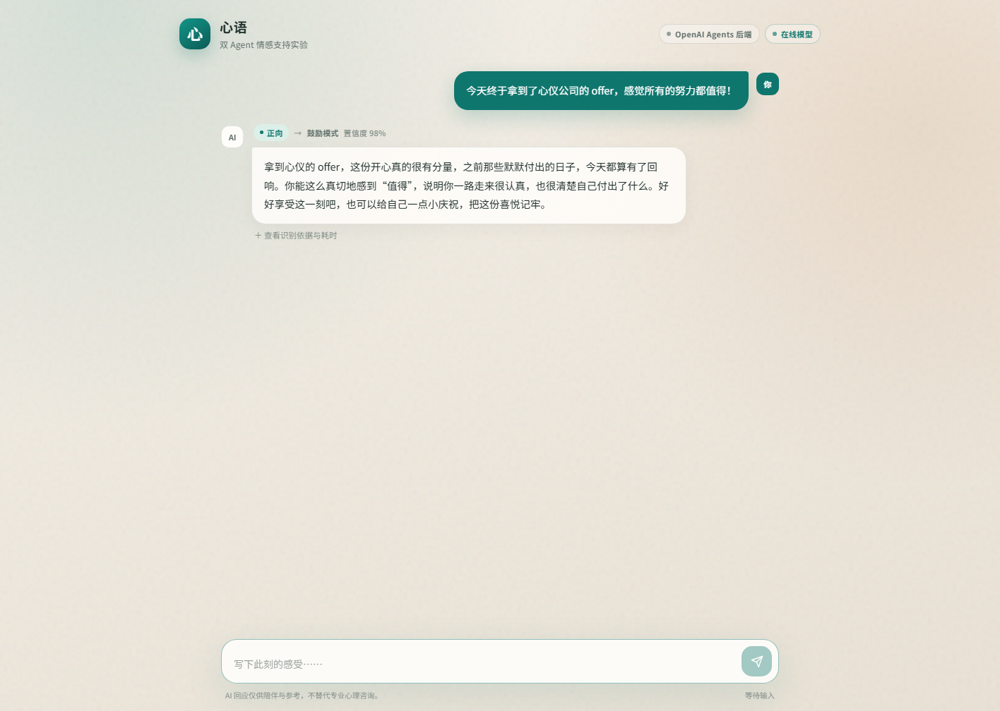

# 第15周作业：双 Agent 情感支持系统

分别使用 **LangGraph** 和 **OpenAI Agents SDK** 实现一个情感支持应用：

1. 进程 1：接收用户文本，做情感识别；
2. 进程 2：读取识别结果，正向则鼓励，负面则排解；
3. 后端：接收前端输入，串联进程 1 和进程 2；
4. 前端：浏览器页面 + 独立终端 CLI，负责用户输入与结果展示；
5. 作业 2：为 OpenAI Agents 版本编写 Dockerfile，并提供 Docker / 阿里云 ACR 打包步骤。



## 1. 实现概览

```text
                       浏览器 UI  /  frontend_cli.py
                                  │
                         POST /api/chat
                                  ▼
                    FastAPI 后端（8000 / 8001）
                                  │
                                  ▼
                 ┌─────────────────────────────────┐
                 │ 进程 1：情感识别                 │
                 │ positive / negative / neutral    │
                 │ confidence + reason（JSON）       │
                 └────────────────┬────────────────┘
                                  │
               ┌──────────────────┼──────────────────┐
               ▼                  ▼                  ▼
         positive            negative            neutral
         鼓励进程             排解进程             陪伴进程
               └──────────────────┼──────────────────┘
                                  ▼
                     统一 JSON 响应 → 前端展示
```

- 情感识别结果是结构化 JSON：`label`、`confidence`、`reason`。
- 正向进入鼓励分支，负向进入排解分支；额外支持中性分支，避免把中性文本硬分成正/负。
- 两套实现的输入输出协议完全一致，前端可以无缝切换后端。

## 2. 两种实现对照

| 作业要求 | LangGraph 版本 | OpenAI Agents 版本 |
|---|---|---|
| 进程 1 | 图节点 `process1_sentiment` | Agent「情感识别进程」 |
| 结果传递 | 写入 `PipelineState.sentiment` | 后端解析 `final_output` 后传入进程 2 |
| 正向分支 | 条件边 → `process2_encourage` | `encourage_agent` |
| 负向分支 | 条件边 → `process2_comfort` | `comfort_agent` |
| 中性分支 | 条件边 → `process2_neutral` | `neutral_agent` |
| 后端串联 | `build_graph().ainvoke()` | 顺序调用两次 `Runner.run()` |
| 后端服务 | `langgraph_app/server.py` | `openai_agents_app/server.py` |
| 默认端口 | 8000 | 8001 |

### LangGraph

`langgraph_app/pipeline.py` 使用 `StateGraph`：

```text
START → process1_sentiment
          ├─ positive → process2_encourage → END
          ├─ negative → process2_comfort   → END
          └─ neutral  → process2_neutral   → END
```

条件边通过 `ROUTE_BY_LABEL` / `ROUTE_NODE_NAMES` 把情感标签映射到明确的路由名和节点，便于测试和调试。

### OpenAI Agents SDK

`openai_agents_app/pipeline.py` 创建四个 Agent：

- 情感识别进程
- 鼓励进程
- 排解进程
- 陪伴进程

后端先 `await Runner.run(情感识别进程)`，解析 JSON，再根据标签选择对应 Agent 执行第二次 `Runner.run`。这对应作业中的“后端进程串联进程 1 和进程 2”，而不是把分支逻辑隐藏在一次模型调用里。

> 模型接入使用 `OpenAIChatCompletionsModel`，兼容 DeepSeek 的 OpenAI 兼容接口；同时关闭 Agents SDK 的 OpenAI 云端 tracing，避免向外部服务发送追踪数据。

## 3. 目录结构

```text
week15_homework/
├── common/                     # 两套实现共享的配置、协议、提示词、解析器
│   ├── api.py                  # FastAPI 应用工厂、错误映射、健康检查
│   ├── config.py               # .env / 环境变量配置
│   ├── mock.py                 # 离线规则演示模式
│   ├── parsing.py              # 宽容的 JSON 解析
│   ├── prompts.py              # 进程 1 / 进程 2 提示词
│   └── schemas.py              # Pydantic 请求、响应、情感结果
├── langgraph_app/
│   ├── pipeline.py             # StateGraph + 条件分支
│   └── server.py               # LangGraph 后端（8000）
├── openai_agents_app/
│   ├── pipeline.py             # 四个 Agent + 顺序编排
│   └── server.py               # Agents 后端（8001）
├── frontend/
│   └── index.html              # 响应式聊天前端，无外部 CDN 依赖
├── frontend_cli.py             # 独立终端前端进程（仅标准库）
├── tests/                      # 19 个离线测试
├── Dockerfile                  # 作业 2：Agents 版本镜像
├── docker-compose.yml          # 可选的一键启动
├── requirements*.txt
├── .env.example
├── .dockerignore
└── README.md
```

## 4. 快速开始

### 4.1 安装依赖

建议 Python 3.12（Docker 镜像同样使用 3.12-slim）。

```bash
cd week15_homework

python -m venv .venv
# Windows:
.venv\Scripts\activate
# macOS / Linux:
# source .venv/bin/activate

python -m pip install -r requirements.txt
```

### 4.2 配置环境变量

复制模板：

```bash
# Windows PowerShell
Copy-Item .env.example .env
# macOS / Linux
cp .env.example .env
```

没有模型 Key 时，先使用离线演示模式：

```dotenv
LLM_MODE=mock
```

接入 DeepSeek / 其他 OpenAI 兼容端点：

```dotenv
LLM_MODE=llm
OPENAI_API_KEY=sk-your-real-key
OPENAI_BASE_URL=https://api.deepseek.com
OPENAI_MODEL=deepseek-chat
REQUEST_TIMEOUT=90
```

也可以使用 `DEEPSEEK_API_KEY`、`DEEPSEEK_BASE_URL`、`DEEPSEEK_MODEL` 这三个别名。

### 4.3 分别启动两个后端

打开两个终端，均在本目录下执行：

```bash
# 终端 A：LangGraph 版本
python -m uvicorn langgraph_app.server:app --host 127.0.0.1 --port 8000

# 终端 B：OpenAI Agents 版本
python -m uvicorn openai_agents_app.server:app --host 127.0.0.1 --port 8001
```

打开浏览器：

- LangGraph 前端：<http://127.0.0.1:8000/>
- OpenAI Agents 前端：<http://127.0.0.1:8001/>
- 接口文档：`/docs`

### 4.4 使用终端前端进程

浏览器之外，也可以把前端作为一个独立进程运行：

```bash
python frontend_cli.py --url http://127.0.0.1:8000
python frontend_cli.py --url http://127.0.0.1:8001
```

单条消息模式（适合脚本验证）：

```bash
python frontend_cli.py --url http://127.0.0.1:8001 --once "今天升职加薪了，太开心了！"
```

### 4.5 健康检查

```bash
curl http://127.0.0.1:8000/api/health
curl http://127.0.0.1:8001/api/health
```

`mode` 为 `mock` 时表示离线演示；为 `llm` 时，`api_key_configured` 表示是否已配置 Key。

## 5. API 约定

### 请求

```http
POST /api/chat
Content-Type: application/json
```

```json
{"message": "最近压力好大，晚上总是睡不着，觉得自己什么都做不好。"}
```

### 响应

```json
{
  "framework": "openai-agents",
  "mode": "mock",
  "sentiment": {
    "label": "negative",
    "confidence": 0.78,
    "reason": "离线演示规则检测到 1 处负向情绪线索。"
  },
  "route": "comfort",
  "reply": "听起来这件事真的消耗了你很多，难受并不是你不够坚强。……",
  "elapsed_ms": 0
}
```

- `label`：`positive` / `negative` / `neutral`
- `route`：`encourage` / `comfort` / `neutral`
- `mode`：`llm` / `mock`
- `elapsed_ms`：整个串联流程的耗时

### curl 示例

```bash
curl -X POST http://127.0.0.1:8000/api/chat \
  -H "Content-Type: application/json" \
  -d '{"message":"今天拿到了心仪的 offer，太开心了！"}'
```

## 6. 实现细节

### 6.1 进程 1：严格 JSON 输出

进程 1 的提示词要求模型只返回：

```json
{"label":"positive|negative|neutral","confidence":0.0,"reason":"判断依据"}
```

`common/parsing.py` 兼容模型偶尔返回 Markdown 代码块或前缀说明的情况，但**不会**在缺少标签时静默猜测情感；无法解析时后端返回 502 并提示重试。

### 6.2 进程 2：按分支使用不同提示词

- 正向：具体肯定用户的开心、努力或收获；
- 负向：先共情，再给一个很小的自我照顾建议，不强行积极；
- 中性：陪伴和梳理，不硬贴正/负标签；
- 共同约束：不做心理诊断、不提供药物建议；任意分支若出现自伤/伤人风险，优先提示联系可信任的人、当地急救或心理援助热线。

### 6.3 后端

- FastAPI 异步接口，模型调用不阻塞事件循环；
- 请求级超时、配置错误（503）、模型解析错误（502）、超时（504）分别处理；
- 日志只记录异常，不返回 API Key；
- 两套后端共用 `common/api.py`，接口协议一致；
- CORS 可通过 `CORS_ORIGINS` 配置，默认 `*` 仅适合本地演示。

### 6.4 前端

- 浏览器页面展示后端框架、当前模式、情感标签、分支、置信度、识别依据和耗时；
- 终端 CLI 使用 Python 标准库，不需要额外安装依赖；
- 用户文本通过 `textContent` 渲染，避免把用户输入当 HTML 执行。

### 6.5 离线演示模式

`LLM_MODE=mock` 使用关键词规则模拟情感识别和回应，目的是：

- 无 Key / 无网络时跑通完整流程；
- 对图路由、API、前端、健康检查做确定性测试；
- 避免测试消耗真实 token。

它不是大模型，不能代表真实模型的识别效果。界面和响应中的 `mode` 字段会明确标记 `mock`。

## 7. 测试与验证

### 7.1 自动化测试

```bash
python -m unittest discover -v
```

测试包会自动设置 `LLM_MODE=mock`，不会访问真实模型。本次结果：

```text
Ran 19 tests
OK
```

覆盖：

- JSON 解析（含 Markdown 围栏、前缀说明、非法输入、中文标签、百分比置信度）；
- mock 情感规则的正面、负面、中性、否定词；
- LangGraph 正向/负向条件分支；
- OpenAI Agents 正向/负向/中性分支；
- 两个 FastAPI 后端的健康检查、页面、聊天契约、空消息校验、OpenAPI。

### 7.2 手工验证

- 两个后端均在 `LLM_MODE=mock` 和 `LLM_MODE=llm` 下启动成功；
- `/api/health` 返回正确框架、模式和 `api_key_configured: true`；
- 两套实现的真实 HTTP 聊天请求均返回 200；
- 使用无头 Edge 实际渲染页面并提交消息，确认情感标签、分支、回复卡片布局正常（见 `docs/screenshot.png`），并检查了移动端宽度；
- 终端前端 `frontend_cli.py --once` 端到端调用成功；
- 对 Docker 镜像所用依赖执行了 `pip install --dry-run`，依赖可解析。

### 7.3 真实模型联调结果

使用有效的 DeepSeek `deepseek-chat` 完成了两套实现的真实端到端验证：

| 实现 | 输入场景 | 识别结果 | 路由 | 耗时 |
|---|---|---|---|---|
| LangGraph | 收到心仪 offer | positive / 0.98 | encourage | 3165 ms |
| LangGraph | 工作压力、失眠、自我否定 | negative / 0.95 | comfort | 2326 ms |
| OpenAI Agents | 收到心仪 offer | positive / 0.98 | encourage | 3356 ms |
| OpenAI Agents | 工作压力、失眠、自我否定 | negative / 0.95 | comfort | 2073 ms |

此外，两套 FastAPI 后端的真实 HTTP 调用均返回 200，`/api/health` 显示 `mode=llm`、`api_key_configured=true`。API Key 只保存在被 `.gitignore` 和 `.dockerignore` 排除的本地 `.env` 中，没有写入代码或镜像。

## 8. 作业 2：Dockerfile 与镜像打包

### 8.1 Dockerfile 设计

- 基础镜像 `python:3.12-slim`；
- 只安装 OpenAI Agents 版本运行依赖（不安装 LangGraph，减小镜像）；
- 依赖层与源码层分离，改代码不会重复安装依赖；
- 使用非 root 用户 `appuser` 运行；
- 不复制 `.env`，API Key 只在运行时注入；
- 内置健康检查；
- 支持通过 `PIP_INDEX_URL` 构建参数切换 pip 镜像源。

### 8.2 本地构建与运行

```bash
# 构建（默认 PyPI；国内网络可加 --build-arg 使用阿里云 pip 镜像）
docker build -t week15-sentiment-agent:1.0 .

docker build \
  --build-arg PIP_INDEX_URL=https://mirrors.aliyun.com/pypi/simple/ \
  -t week15-sentiment-agent:1.0 .
```

无 Key 的离线演示：

```bash
docker run --rm -p 8000:8000 \
  -e LLM_MODE=mock \
  week15-sentiment-agent:1.0
```

使用真实模型（`--env-file` 在运行时注入，镜像内没有密钥）：

```bash
docker run --rm -p 8000:8000 \
  --env-file .env \
  week15-sentiment-agent:1.0
```

打开 <http://127.0.0.1:8000/>。

使用 Compose：

```bash
copy .env.example .env    # 修改 LLM_MODE / API Key
docker compose up --build -d
docker compose logs -f
docker compose down
```

查看镜像和健康状态：

```bash
docker images | grep week15
docker ps
docker inspect --format='{{json .State.Health}}' week15-sentiment-agent
```

### 8.3 推送到阿里云容器镜像服务 ACR

先登录阿里云，创建容器镜像服务实例、命名空间和镜像仓库。以下命令以个人版、杭州区域为例：

```bash
# 1. 登录（密码为 ACR 的访问凭证，不是阿里云登录密码）
docker login --username=<阿里云账号> registry.cn-hangzhou.aliyuncs.com

# 2. 给本地镜像打标签
docker tag week15-sentiment-agent:1.0 \
  registry.cn-hangzhou.aliyuncs.com/<命名空间>/week15-sentiment-agent:1.0

# 3. 推送
docker push \
  registry.cn-hangzhou.aliyuncs.com/<命名空间>/week15-sentiment-agent:1.0

# 4. 在任意装有 Docker 的服务器拉取运行
docker pull registry.cn-hangzhou.aliyuncs.com/<命名空间>/week15-sentiment-agent:1.0
docker run -d --name week15-agent -p 8000:8000 \
  --env-file .env \
  registry.cn-hangzhou.aliyuncs.com/<命名空间>/week15-sentiment-agent:1.0
```

如果本机没有 Docker，也可以使用 ACR 的云端构建：

1. 将本目录代码推送到 GitHub / 阿里云 Codeup；
2. 在 ACR 控制台创建镜像仓库，选择“构建”；
3. 构建上下文设为仓库根目录，Dockerfile 路径填 `Dockerfile`；
4. 选择分支并触发构建，构建完成后在仓库中获取镜像地址即可。

苹果芯片机器跨平台构建（服务器通常是 amd64）：

```bash
docker buildx build --platform linux/amd64 \
  -t registry.cn-hangzhou.aliyuncs.com/<命名空间>/week15-sentiment-agent:1.0 \
  --push .
```

> 注意：不要把 `.env` 提交到 Git 或打进镜像。`.gitignore` 和 `.dockerignore` 已排除该文件。

服务器上的运行与 `.env` 注入步骤见 [`deploy/DEPLOY.md`](deploy/DEPLOY.md)。

## 9. 作业要求对照

| 作业要求 | 对应实现 |
|---|---|
| 进程 1 接受请求进行情感识别 | `process1_sentiment` / `sentiment_agent` |
| 进程 2 得到结果后正向鼓励、负面排解 | LangGraph 条件分支；Agents 三个回应 Agent |
| 后端进程接受前端输入、串联两个进程 | FastAPI `POST /api/chat` + `build_graph().ainvoke()` / 两次 `Runner.run()` |
| 前端进程用户输入 | `frontend/index.html` + `frontend_cli.py` |
| 使用 langgraph 和 openai-agents 分别实现 | `langgraph_app/` + `openai_agents_app/` |
| 基于 Agents 版本编写 Dockerfile | 根目录 `Dockerfile` |
| 通过 Docker 或阿里云镜像服务打包 | `docker-compose.yml`、ACR 构建/推送步骤 |

## 10. 已知限制与可扩展方向

- 每次请求独立处理，不保存多轮会话记忆；可接 LangGraph checkpointer 或 Agents SDK session。
- 情感识别是模型判断，不是心理诊断；生产环境应增加人工兜底和危机干预流程。
- 演示模式使用简单关键词规则，不能代替真实模型评估。
- 尚未加入鉴权、限流、审计日志、TLS；生产部署应放在网关之后。
- 可在进程 2 后增加安全审查进程，或将 `Runner.run` 改成流式输出，提高等待体验。
- 真实模型已完成端到端联调；本机 Docker 构建受 Windows 组件存储问题影响时，可直接使用 ACR 云端构建。
